# SHERPY — agente de asesoría financiera personal

Backend del agente de IA de **SHERPY** para la hackathon de **Sherpas**. Para cada familia, el agente:

1. **obtiene el contexto** de su caso con los datos de Sherpas (MCP oficial o copia local),
2. **hace los cálculos** con funciones deterministas en Python (el LLM nunca hace cuentas),
3. **da recomendaciones adaptadas** a esa familia: su score, sus prioridades, su perfil de riesgo y su forma de decidir.

Se expone como una **API HTTP con streaming** que consume un cliente externo (fuera de este repo).

> ⚠️ Los 4 casos son **ficticios y sintéticos** (USD, contexto fiscal de EE. UU.). Las respuestas son información educativa, no asesoramiento financiero regulado.

---

## Índice

1. [Estado actual](#1-estado-actual)
2. [Arquitectura](#2-arquitectura)
3. [Qué pasa en una pregunta](#3-qué-pasa-en-una-pregunta)
4. [Datos: MCP de Sherpas y copia local](#4-datos-mcp-de-sherpas-y-copia-local)
5. [Herramientas del agente](#5-herramientas-del-agente)
6. [Cálculos y validación contra Sherpas](#6-cálculos-y-validación-contra-sherpas)
7. [Las 4 familias en cifras](#7-las-4-familias-en-cifras)
8. [Reglas de comportamiento del agente](#8-reglas-de-comportamiento-del-agente)
9. [API](#9-api)
10. [Instalación y arranque](#10-instalación-y-arranque)
11. [Tests](#11-tests)
12. [Estructura del repositorio](#12-estructura-del-repositorio)
13. [Ramas de git](#13-ramas-de-git)
14. [Seguridad](#14-seguridad)
15. [Pendiente y próximos pasos](#15-pendiente-y-próximos-pasos)

---

## 1. Estado actual

| Pieza | Estado | Detalle |
|---|---|---|
| Cálculos `calc_*` | ✅ Funciona | 6 funciones puras; impuestos, FICA y fondo de emergencia **cuadran al céntimo** con Sherpas en los 4 casos |
| Datos (MCP + local) | ✅ Funciona | MCP oficial con token Bearer; copia local idéntica; caché en memoria |
| Elección de fuente | ✅ Funciona | El agente decide en cada consulta `local` (rápido) o `mcp` (dato puntual) |
| Agente LLM | ✅ Funciona | LLM de Sherpas (`gpt-5-mini`) + respaldo opcional Gemini / Groq |
| API HTTP | ✅ Funciona | `/health`, `/cases`, `/chat` con Server-Sent Events |
| Tests | ✅ 48 en verde | En la rama `test`, sin red |
| Hosting | ⏳ Pendiente | Aún sin desplegar |
| Cliente / frontend | ➖ Fuera de este repo | — |

Probado de punta a punta con el LLM y el MCP reales: el agente lee el caso, llama a la calculadora y responde citando cada dato.

---

## 2. Arquitectura

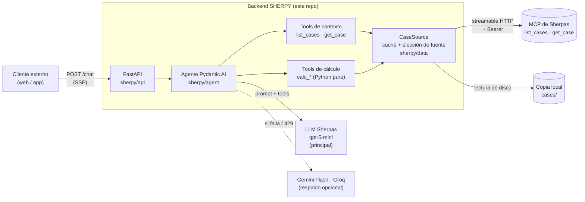

**Ideas clave**

- **El LLM razona y redacta, no calcula.** Cada número nuevo sale de una función `calc_*` testeada o de los datos de Sherpas.
- **Los cálculos no dependen del LLM** (`sherpy/calcs/`): se testean aislados y se validan contra las métricas que ya publica Sherpas.
- **Nunca se manda un archivo grande entero al LLM.** `financial-health` (~18k tokens) e `investment-analysis` (~21k) se piden por sección.
- **Coste cero:** LLM de la hackathon y servicios con plan gratuito; sin bases de datos, sin RAG, sin fine-tuning.

---

## 3. Qué pasa en una pregunta

Ejemplo real con la familia Johnson: *"Si pagamos 300 dólares extra al mes en la tarjeta, ¿cuánto antes la liquidamos y cuánto ahorramos en intereses?"*

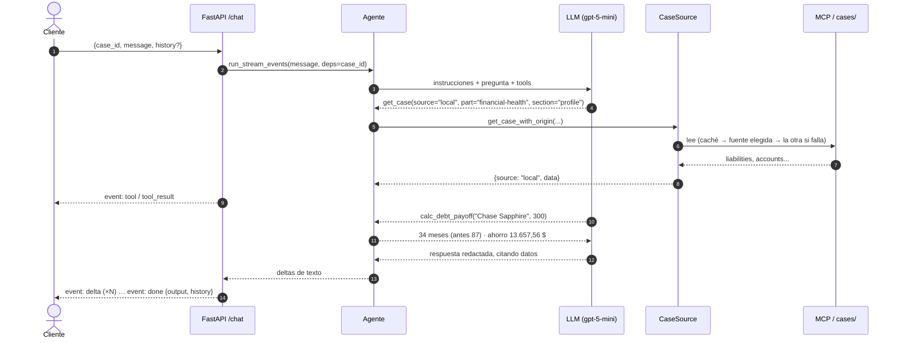

Respuesta obtenida (resumen): *"Con +300 $/mes la Chase Sapphire se liquida en **34 meses** en lugar de 87 y ahorráis **13.657,56 $** de intereses (fuente: `financial-health → profile` y la calculadora de amortización)."* Las cifras coinciden exactamente con `calc_debt_payoff` ejecutado por separado.

---

## 4. Datos: MCP de Sherpas y copia local

Cada caso tiene 5 partes (iguales en el MCP y en `cases/<caseId>/`):

| Parte | Formato | Tamaño aprox. | Para qué sirve |
|---|---|---|---|
| `signals` | JSON | ~1,3k tokens | Eventos que afectan a la familia (mercado, normas, vida, decisiones). **Mejor contexto inicial** |
| `financial-health` | JSON | ~18k tokens | Hogar, score y pilares, `top_moves`, perfil (ingresos, gastos, cuentas, deudas, seguros, objetivos), `key_metrics`, proyecciones |
| `persona` | Markdown | ~2,3k tokens | D0–D6 (patrimonio, etapa, complejidad, huecos, riesgo, **estilo de decisión**, **motivación**), alertas y tensiones. **Fuente de la personalización** |
| `investment-analysis` | JSON | ~21k tokens | Posiciones, concentración, rendimiento, caídas históricas |
| `legal-values` | JSON | ~1,6k tokens | Tramos IRS, deducción estándar, crédito por hijo, FICA (2026 y 2027) |

### Elección de fuente en cada consulta

El agente decide en **cada** lectura si usa la copia local o la API oficial:

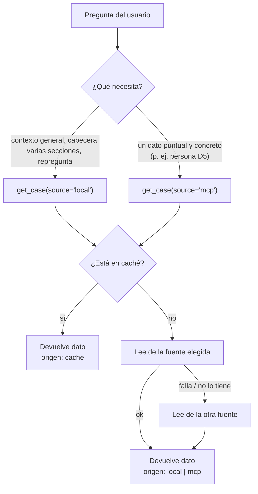

Latencias medidas (misma máquina, MCP real):

| Consulta | Local | MCP |
|---|---:|---:|
| Cabecera del caso | 13,0 ms | 601,2 ms |
| `persona` → D5 | 0,9 ms | 57,2 ms |
| `financial-health` → `score` | 4,3 ms | 63,5 ms |
| `financial-health` → `key_metrics` | 3,7 ms | 69,4 ms |

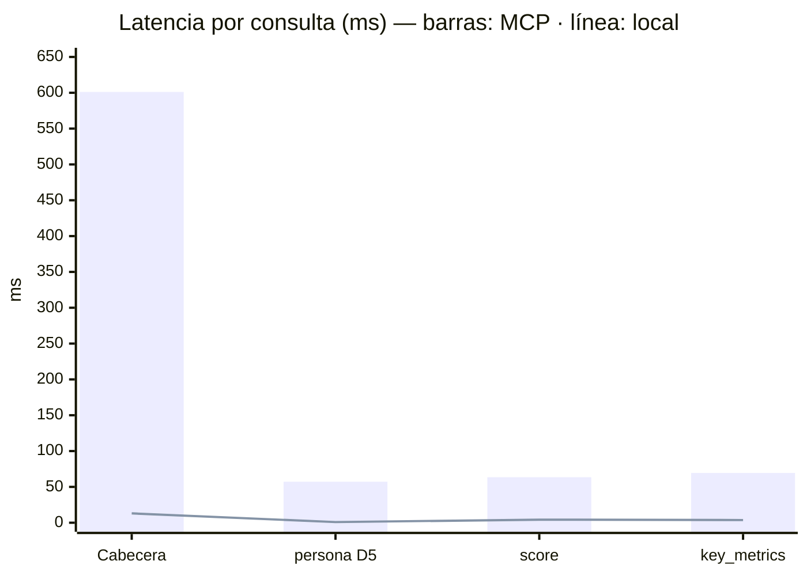

Local siempre es más rápido; el MCP aporta el dato de la fuente oficial. Ambos son **idénticos** (verificado parte por parte). El evento `tool_result` del stream informa del origen real (`cache`, `local` o `mcp`).

---

## 5. Herramientas del agente

### Contexto

| Tool | Qué hace |
|---|---|
| `list_cases()` | Los 4 casos con hogar, ciudad, score y banda |
| `get_case(source, part?, section?)` | Lee el **caso activo**. Sin `part` → cabecera con secciones y tamaños. Obliga a pedir sección en las partes grandes. Devuelve `{source, data}` |

### Cálculo (`sherpy/calcs/`, Python puro)

| Tool | Fórmula | Fuente de los parámetros |
|---|---|---|
| `calc_federal_tax(year)` | salarios − aportaciones pre-tax (401k tradicional + HSA) − deducción estándar → tramos → − crédito por hijo (< 17 años, phase-out de 50 $ por cada 1.000 $ sobre el umbral) | `legal-values` 2026/2027 |
| `calc_fica(year)` | Seguridad Social 6,2 % hasta el wage base (por persona) + Medicare 1,45 % + Additional Medicare 0,9 % sobre el umbral del hogar | `legal-values` |
| `calc_emergency_fund(target_months)` | (checking + savings + money market) / (gastos + cuotas de deuda) → meses, objetivo y hueco | `profile`, `key_metrics` |
| `calc_debt_payoff(debt_name, extra_monthly)` | Amortización mensual: meses e intereses, con y sin pago extra | `profile.liabilities` |
| `calc_goal_gap(goal, assumed_return, current_savings?)` | Universidad: 529/UGMA proyectados vs coste · Compras: entrada + cierre vs ahorro · Jubilación: métricas de Sherpas | `profile.goals`, `key_metrics` |
| `calc_market_shock(drop_pct)` | Caída aplicada a lo invertido (sin efectivo ni money market), por cuenta y en meses de gastos | `investment-analysis.positions` |

Supuestos explícitos de `calc_goal_gap` (el agente debe decirlos): rentabilidad anual por defecto del 5 %; si una cuenta 529 no menciona a un hijo, se reparte a partes iguales; en compras se parte de 0 $ ahorrados salvo que el usuario indique otra cosa.

---

## 6. Cálculos y validación contra Sherpas

Los tests comparan nuestras funciones con las cifras que **Sherpas ya publica** en `key_metrics`:

| Familia | Impuesto federal (nuestro = Sherpas) | FICA (nuestro = Sherpas) | Meses de colchón (nuestro = Sherpas) |
|---|---:|---:|---:|
| Johnson | 44.668 $ ✅ | 21.690 $ ✅ | 1,4 ✅ |
| Carter | 26.894 $ ✅ | 13.770 $ ✅ | 3,2 ✅ |
| Lewis | 51.304 $ ✅ | 15.514 $ ✅ | 7,9 ✅ |
| Weah | 36.268 $ ✅ | 20.835 $ ✅ | 16,0 ✅ |

Hallazgos al cuadrar con Sherpas:

- El "Federal Income Tax" de Sherpas **no descuenta el crédito por hijo** y **sí resta** las aportaciones pre-tax (401k tradicional + HSA). Por eso `calc_federal_tax` devuelve `tax_before_credits` (= Sherpas) y `tax_after_credits` (con el crédito: 4.400 $ menos para Johnson y Weah).
- El efectivo accesible de Sherpas incluye el **money market** del broker, no solo checking + savings.
- La FICA usa el wage base de **2026 (184.500 $)**; Samantha lo supera y paga Additional Medicare sobre 50.000 $.

---

## 7. Las 4 familias en cifras

| caseId | Hogar | Ciudad | Score | Banda | Perfil de riesgo |
|---|---|---|---:|---|---|
| `daniel-emily-johnson` | Pareja 44/42, hijos 11 y 9 | Denver, CO | 52 | 🟠 vulnerable | Growth / Moderate |
| `michael-carter` | Soltero 37 | Austin, TX | 26 | 🔴 critical | Growth |
| `samantha-lewis` | Madre 47, hijos 18 y 16 | Miami, FL | 82 | 🟢 strong | Growth |
| `timothy-melanie-weah` | Pareja 40/38, hijos 6 y 3 | San Francisco, CA | 60 | 🟡 stable | Growth / Moderate |

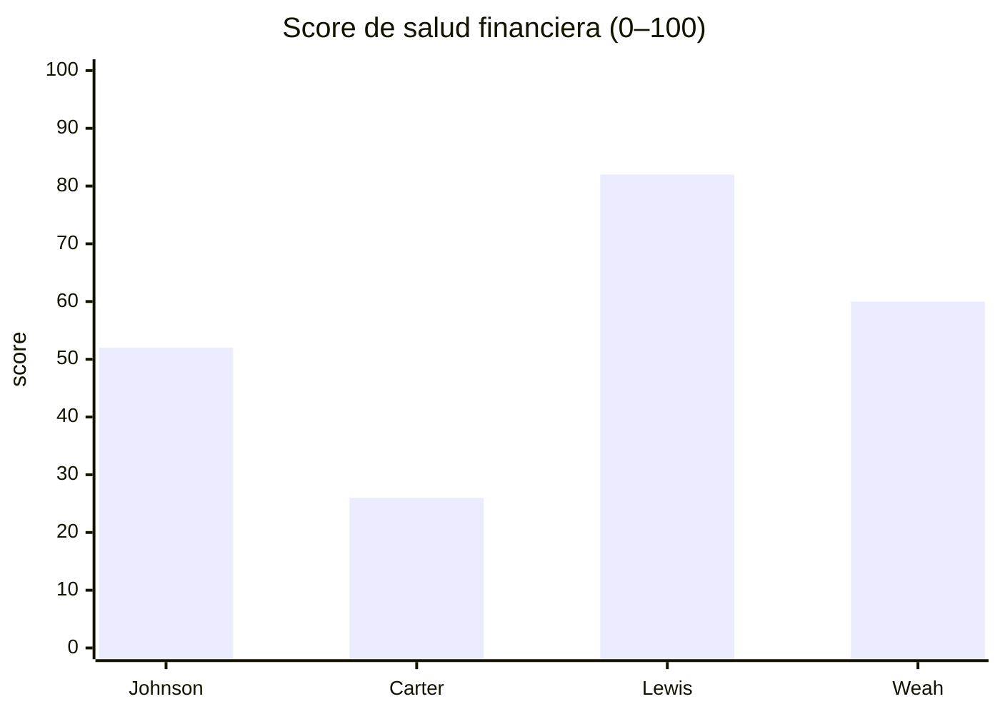

### Pilares del score (puntos / máximo)

| Pilar | Johnson | Carter | Lewis | Weah |
|---|---:|---:|---:|---:|
| Ahorro y flujo de caja | 16/30 | **0/25** | 22/30 | 26/30 |
| Deuda | 15/20 | 8/10 | 20/20 | 12/20 |
| Inversiones | 8/15 | 11/25 | 10/15 | 8/15 |
| Liquidez y fondo de emergencia | 13/15 | 4/20 | 15/15 | 15/15 |
| Seguros y protección | **0/20** | 4/20 | 14/20 | 7/20 |

### Fondo de emergencia (meses que cubre el efectivo)

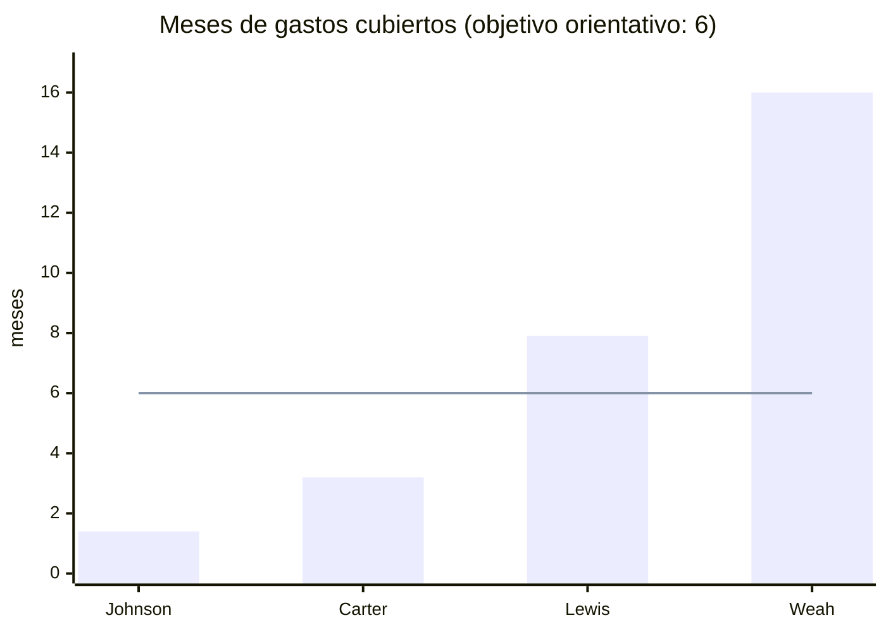

| Familia | Efectivo accesible | Salidas mensuales | Meses |
|---|---:|---:|---:|
| Johnson | 19.000 $ | 13.357,50 $ | 1,4 |
| Carter | 30.000 $ | 9.306,00 $ | 3,2 |
| Lewis | 80.000 $ | 10.125,00 $ | 7,9 |
| Weah | 150.800 $ | 9.397,50 $ | 16,0 |

### Tarjetas de crédito: pagar 300 $ extra al mes

| Familia | Tarjeta | Saldo | TAE | Meses (cuota actual → +300 $) | Intereses ahorrados |
|---|---|---:|---:|---:|---:|
| Johnson | Chase Sapphire | 18.000 $ | 24,9 % | 87 → **34** | 13.658 $ |
| Carter | Amex Platinum | 3.500 $ | 20,0 % | 21 → **8** | 419 $ |
| Weah | Chase CC | 18.000 $ | 18,0 % | 155 → **41** | 22.304 $ |

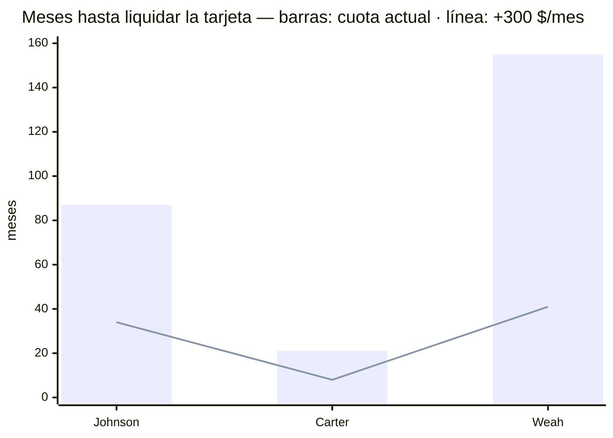

### Caída de mercado del 20 %

| Familia | Invertido (sin efectivo) | Pérdida | Equivale a… meses de gastos |
|---|---:|---:|---:|
| Johnson | 313.000 $ | 62.600 $ | 4,7 |
| Carter | 138.500 $ | 27.700 $ | 3,0 |
| Lewis | 335.000 $ | 67.000 $ | 6,6 |
| Weah | 205.800 $ | 41.160 $ | 4,4 |

### Acciones que más suben el score (`top_moves` de Sherpas)

| Familia | 1.ª acción | Score antes → después |
|---|---|---:|
| Johnson | Raise mortality coverage (más seguro de vida) | 52 → 57 |
| Carter | Lower the withdrawal rate (bajar la tasa de retirada) | 26 → 62 |
| Lewis | Close a coverage gap (cerrar un hueco de cobertura) | 82 → 84 |
| Weah | Pay down revolving card (pagar la tarjeta) | 60 → 62 |

---

## 8. Reglas de comportamiento del agente

Definidas en `sherpy/agent/prompts.py` (fuente: `CLAUDE.md`):

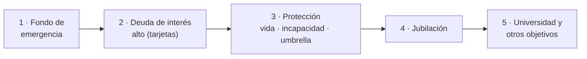

1. **El LLM nunca hace cuentas**: todo número nuevo sale de `calc_*` o de los datos.
2. **No inventa datos** y cita la parte/sección que respalda cada recomendación.
3. Sigue las **prioridades** de arriba y se apoya en `score.top_moves` / `combined_moves`, explicando el porqué con los pilares.
4. **Personaliza con `persona`**: respeta el perfil de riesgo de cada miembro (si la pareja difiere, explica el plan a los dos), adapta la explicación al estilo de decisión (D5) y habla de su motivación (D6).
5. Bandas `critical` / `vulnerable`: **pocas acciones concretas** y nunca más riesgo.
6. Tono cercano, sin jerga; **máximo 3 acciones** salvo que pidan más.
7. Aviso de "información educativa" **una sola vez** por conversación.
8. Responde en el **idioma del usuario**.
9. Elige la **fuente de datos** en cada consulta (sección 4).

---

## 9. API

| Método | Ruta | Respuesta |
|---|---|---|
| `GET` | `/health` | `{status, data_source: "mcp" \| "local", llm_configured}` |
| `GET` | `/cases` | Lista de los 4 casos (como `list_cases`) |
| `POST` | `/chat` | `text/event-stream` (Server-Sent Events) |

### `POST /chat`

```json
{ "case_id": "michael-carter", "message": "¿Qué hago primero?", "history": null }
```

Eventos del stream:

| Evento | Datos | Cuándo |
|---|---|---|
| `tool` | `{name, args}` | El agente llama a una herramienta |
| `tool_result` | `{name, source}` | Termina la herramienta (`source`: `cache` / `local` / `mcp` en `get_case`) |
| `delta` | `{text}` | Trozo de la respuesta |
| `done` | `{output, history}` | Respuesta completa + historial |
| `error` | `{status, message}` | 429 (límite de uso de todos los proveedores), 502/503 (fallo del proveedor) |

La API **no guarda estado**: el cliente reenvía `history` (tal cual lo recibió en `done`) en el siguiente mensaje.

Errores antes del stream: `404` caso inexistente · `422` petición o historial inválido · `503` sin LLM configurado.

```bash
curl -N -X POST localhost:8000/chat -H 'content-type: application/json' \
  -d '{"case_id":"michael-carter","message":"¿Qué hago primero?"}'
```

```text
event: tool
data: {"name": "get_case", "args": {"source": "local", "part": "signals"}}

event: tool_result
data: {"name": "get_case", "source": "local"}

event: delta
data: {"text": "Aviso: esto es información educativa…"}

event: done
data: {"output": "…", "history": [ … ]}
```

---

## 10. Instalación y arranque

Requisitos: Python 3.11+.

```bash
python3 -m venv .venv
.venv/bin/pip install -r requirements.txt
.venv/bin/pip install -e .
cp .env.example .env        # y rellenar las claves
.venv/bin/uvicorn sherpy.api.main:app --reload
```

Variables de entorno (`.env`, **nunca se sube**):

| Variable | Obligatoria | Para qué |
|---|---|---|
| `TEAM_KEY` | Sí (o una de respaldo) | LLM de la hackathon de Sherpas (`gpt-5-mini`) |
| `MCP_URL`, `MCP_TOKEN` | Recomendado | MCP de Sherpas. Sin ellas se usa `cases/` |
| `GOOGLE_API_KEY`, `GROQ_API_KEY` | No | Respaldo si el LLM principal falla |
| `GEMINI_MODEL`, `GROQ_MODEL`, `SHERPAS_LLM_MODEL` | No | Cambiar el ID del modelo |

Comportamiento según configuración:

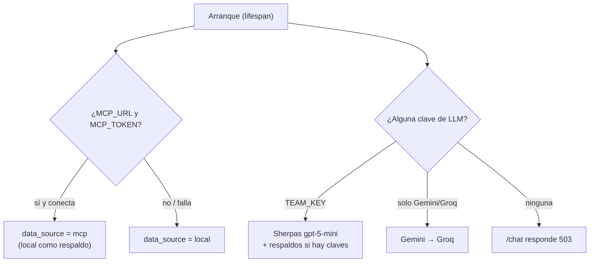

Prueba rápida del LLM: `.venv/bin/python -m sherpy.agent.llm`

---

## 11. Tests

> **Regla del equipo:** los tests se escriben, modifican y ejecutan **siempre en la rama `test`**.

```bash
git switch test
.venv/bin/pytest
```

48 tests, sin red (el agente usa `TestModel` y los datos locales):

| Archivo | Tests | Qué comprueba |
|---|---:|---|
| `test_tax.py` | 9 | Impuesto federal = Sherpas (×4), detalle, phase-out del crédito por hijo, pre-tax, 2027 |
| `test_fica.py` | 6 | FICA = Sherpas (×4), tope de SS y Additional Medicare |
| `test_emergency.py` | 5 | Meses de colchón = Sherpas (×4), hueco |
| `test_debt.py` | 6 | Amortización, cuota insuficiente, fecha de pago = Sherpas, ahorro con extra |
| `test_goals.py` | 6 | Universidad (529/UGMA), compra de casa, jubilación |
| `test_market.py` | 3 | Caída sobre posiciones, respaldo con cuentas, validación |
| `test_source.py` | 8 | Elección local/MCP, caché, respaldo si el MCP cae, Markdown en texto plano |
| `test_api.py` | 5 | `/health`, `/cases`, `/chat` (stream, fuente, historial), 404 |

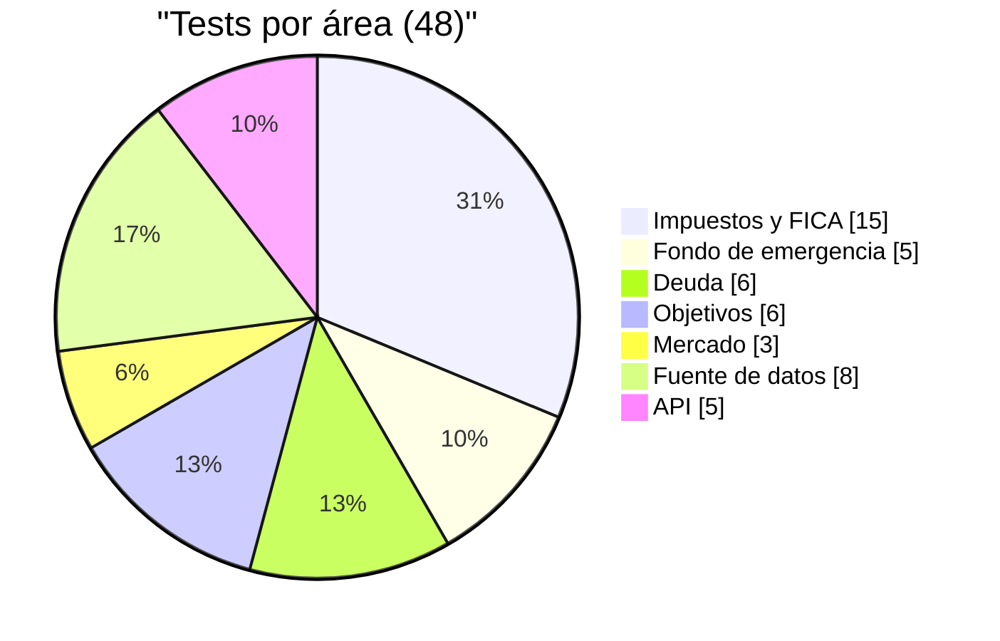

---

## 12. Estructura del repositorio

```text
SHERPY/
├── sherpy/
│   ├── config.py            # Settings desde el entorno / .env
│   ├── calcs/               # Cálculos puros (sin LLM)
│   │   ├── tax.py           #   calc_federal_tax, calc_fica
│   │   ├── cashflow.py      #   calc_emergency_fund
│   │   ├── debt.py          #   calc_debt_payoff
│   │   ├── goals.py         #   calc_goal_gap
│   │   ├── market.py        #   calc_market_shock
│   │   ├── models.py        #   modelos Pydantic de resultados
│   │   └── _helpers.py      #   lectura de legal-values y del perfil
│   ├── data/source.py       # CaseSource: MCPBackend + LocalBackend + caché + elección de fuente
│   ├── agent/
│   │   ├── agent.py         # build_agent(): modelo con respaldo + tools
│   │   ├── llm.py           # conexión al LLM de Sherpas (TEAM_KEY)
│   │   ├── prompts.py       # instrucciones del agente
│   │   └── deps.py          # AgentDeps(case_id, source)
│   └── api/
│       ├── main.py          # FastAPI: lifespan, /health, /cases, /chat (SSE)
│       └── schemas.py       # ChatRequest, HealthResponse
├── tests/                   # pytest (se trabaja en la rama test)
├── cases/<caseId>/          # copia local de los datos de Sherpas (5 partes + report.pdf)
├── legal/                   # muestra del dataset legal
├── requirements.txt         # dependencias con versión exacta
├── pyproject.toml           # paquete + configuración de pytest
├── .env.example             # plantilla de variables (sin secretos)
└── CLAUDE.md                # contexto y reglas para trabajar con Claude
```

---

## 13. Ramas de git

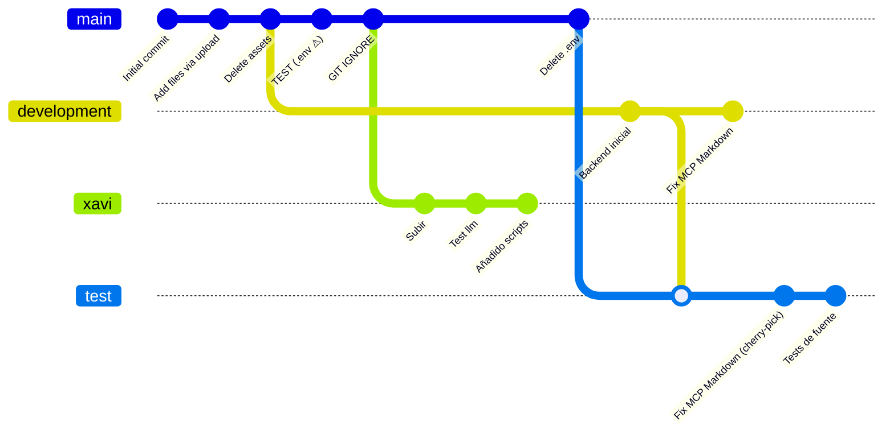

| Rama | Contenido | Estado |
|---|---|---|
| `main` | Datos iniciales + prueba de LLM/MCP (`src/llm.py`, `src/modelo.py`) | En GitHub |
| `development` | **Este backend** (`sherpy/`) + README + CLAUDE.md | Local, lista para push |
| `test` | `development` + los tests más recientes | Local |
| `xavi` | Trabajo de un compañero (ver abajo) | En GitHub, sin integrar |

### Trabajo en `xavi` (sin integrar)

Scripts en `src/` que leen `data/cases/` y generan contenido educativo:

- `profiling.py`: perfil compacto de cada familia para el LLM.
- `pill_generator.py` / `generate_all.py`: **"píldoras" diarias** de aprendizaje con mini-reto (LangChain + `gpt-5-mini`) → `data/pills.json`.
- `events_builder.py` / `tracker.py`: eventos priorizados por familia (mercado, cambios legales, fechas del plan).
- `finance.py`: cotizaciones en vivo con Finnhub (NVDA, VTI, QQQ) → `data/market_snapshot.json`.

Para integrarlo con este backend habría que alinear rutas (`data/cases/` vs `cases/`), dependencias (LangChain vs Pydantic AI) y reutilizar `CaseSource` y las `calc_*`.

---

## 14. Seguridad

- `.env` está en `.gitignore`; las claves solo se leen del entorno. `.env.example` no contiene secretos.
- `development` está limpia: no hay ningún `.env` ni token en su historial.
- ⚠️ **Hay secretos expuestos en GitHub.** Un `.env` con `MCP_TOKEN`, `TEAM_KEY` y `FINNHUB_KEY` se subió en el commit `6212a1d` (en `main` y `xavi`), y la rama `xavi` lo sigue teniendo en su última versión. Hay que **revocar y renovar esas claves** y, si se quiere limpiar el historial, reescribirlo con `git filter-repo` + force-push (afecta a todo el equipo).

---

## 15. Pendiente y próximos pasos

- [ ] Renovar las claves expuestas y sacar `.env` de `xavi`.
- [ ] Push de `development` y PR hacia `main` (habrá un conflicto trivial en `.gitignore`).
- [ ] Hosting del backend (plan gratuito).
- [ ] Integrar las píldoras y eventos de `xavi` como endpoints usando `CaseSource` y `calc_*`.
- [ ] Más cálculos: seguro de vida necesario, impacto de subir aportaciones al 401k.
- [ ] Respaldo de LLM: añadir `GOOGLE_API_KEY` / `GROQ_API_KEY` para no depender de un solo proveedor.
