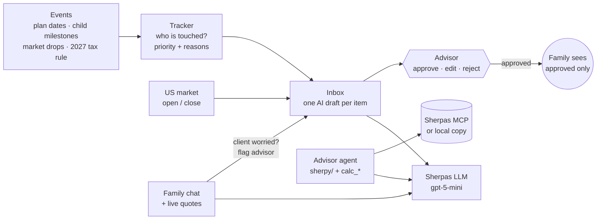
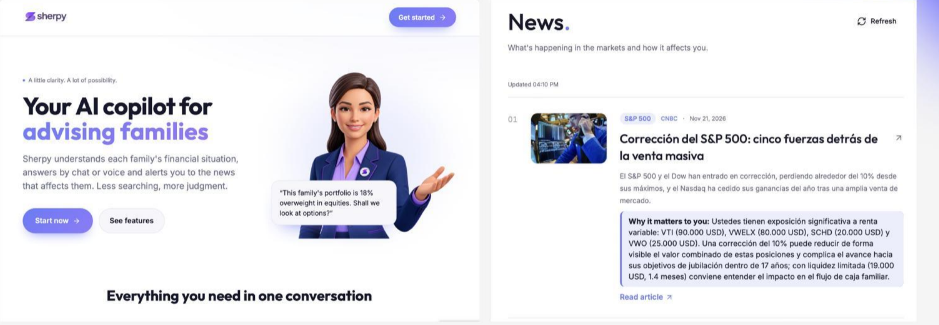

<p align="center">
  
</p>

<p align="center">
  <a href="https://sherpy.lovable.app" target="_blank">
    
  </a>
</p>

<h1 align="center">SHERPY: first to know, first to tell</h1>

<p align="center">
  <strong>CDTM Valencia Hacks 2026</strong><br>
  Sherpas challenge · Saturday 21 November 2026 · The Terminal Hub, Valencia
</p>

Between meetings, every family hears from its advisor first, in its own terms. **The AI drafts, the advisor approves, and nothing reaches the family until approved.**

> ⚠️ The 4 families are fictional and synthetic (USD, US tax context). Answers are educational information, not regulated financial advice.

## The application in one minute

An advisor looks after families, and each one wants to feel like the only one. SHERPY is the assistant that keeps every family close after the plan is delivered. It has two sides:

- **Advisor side:** an inbox of AI-written drafts, one per thing that matters to a family today, ordered by urgency. For each draft the advisor sees *why* it is there (for example "goal: purchase (+75); happens in 41 days (+15)") and can approve it, edit it, or reject it.
- **Family side:** the family only sees messages the advisor approved. They can also chat with an assistant that answers questions about their plan and the market, in their own language. If the client is worried or asks for their advisor, the chat sends a request to the advisor's inbox.

Behind it there are two layers that work on the same four families:

1. **Nurturing layer (`src/`)** finds out *what happened* to each family and writes the draft.
2. **Advisor agent backend (`sherpy/`)** answers *detailed questions* about a family's plan with exact, verified numbers.

## How it works, end to end



1. **Collect events.** Scripts read each family's plan and turn dates, life milestones, market moves and rule changes into events.
2. **Decide who is touched and how much it matters.** The tracker scores every event per family (type, closeness, tech exposure, match with the family's stated concerns) and builds a daily queue: at most 3 per family, 30 overall. A family with nothing important gets a short reassurance ("nothing needs your attention").
3. **Draft.** The model writes an 80-word message in the advisor's name, using only the facts computed in code and the family's profile. In a couple, the wording adapts to the more cautious partner.
4. **Approve.** The advisor decides. Only approved text is visible to the family.
5. **Stay available.** The family can ask questions in chat at any time. Live market data comes from Finnhub, and plan data comes from the family's own plan.

## Layer 1: nurturing (`src/`)

| Part | Files | What it does |
|---|---|---|
| Profiling | `profiling.py` | Compact profile per family: household, risk per person, goals, concerns and tensions from the persona |
| Plan and life events | `events_builder.py` | Dated goals in the next 2 years (home, college) and child milestones (ages 11, 16, 18, 25) |
| Market events | `market_events.py`, `market_poller.py` | If NVDA, VTI or QQQ fall 2% or more, estimates the loss on each family's invested money (cash excluded) and in months of spending. `--shock N` simulates a drop |
| Legal events | `events_legal.py` | The 2027 Social Security wage base ($184,500 → $192,300): only families earning above it get an event (Samantha: about $484 more tax a year) |
| Tracker | `tracker.py` | Priority score with readable reasons, and the daily queue |
| Open/close alerts | `market_sessions.py` | At 9:35 and 16:05 New York time, one draft per family about what happened in the session. A calm day says nothing needs doing |
| Inbox | `inbox.py` | Drafts, approve/edit/reject, and the family's approved-only view |
| Family chat | `chat.py`, `market_tools.py` | Answers in the client's language in about 90 words. Tools: sector performance, any US stock or ETF quote, and `flag_to_advisor` |
| API | `api.py` | HTTP endpoints for the advisor and the family |

Priority levels: `urgent` ≥ 80, `high` ≥ 60, `medium` ≥ 40, `low` below.

Safety rules in the prompts: use only the given facts, never invent figures, never recommend buying or selling a security, never promise outcomes, say that an estimated loss is not money already lost, and never promise a specific day for a call.

## Layer 2: advisor agent (`sherpy/`)

An AI agent that answers detailed questions about one family. Example: *"If we pay an extra $300 a month on the card, how much sooner do we pay it off?"* The agent reads the family's liabilities, calls `calc_debt_payoff`, and answers "34 months instead of 87, and $13,657.56 less interest", citing where each number came from.

**The LLM never does the math.** It reasons and writes; every number comes from a tested Python function or from the plan data.

| Tool | Purpose |
|---|---|
| `list_cases`, `get_case` | Read the families and their data, by section (large files are never sent whole) |
| `calc_federal_tax`, `calc_fica` | Federal income tax and payroll taxes for 2026/2027 |
| `calc_emergency_fund` | Months of spending covered by cash, target and gap |
| `calc_debt_payoff` | Months and interest with and without an extra payment |
| `calc_goal_gap` | College, home purchase and retirement gaps (assumptions are stated to the user) |
| `calc_market_shock` | What a market drop means for invested money, per account and in months of spending |

**Data.** Each family has 5 parts: `signals`, `financial-health`, `persona`, `investment-analysis`, `legal-values`. The agent chooses on every query between the local copy (fast) and the official Sherpas MCP (single data points), with an in-memory cache and automatic fallback to the other source.

**Validation.** Federal tax, FICA and emergency-fund months match the figures Sherpas already publishes, to the cent, in all 4 families.

**Behaviour.** The agent follows a fixed priority (emergency fund → high-interest debt → protection → retirement → college and other goals), respects each person's risk profile and decision style, gives at most 3 actions, and answers in the user's language.

**Interfaces.** HTTP API with streaming (Server-Sent Events) and an OpenAI-compatible `/v1/chat/completions` endpoint, so ElevenLabs can use SHERPY as the brain of a voice agent.

## The four families

| Family | Household | Score | Main story |
|---|---|---:|---|
| Johnson | Couple 44/42, 2 children, Denver | 52 | College and retiring at 62; $18,000 card at 24.9% |
| Carter | Single 37, Austin | 26 | Home in 2027 and retiring at 58 |
| Lewis | Mother 47, 2 teenagers, Miami | 82 | College bills now and a second home in 2030 |
| Weah | Couple 40/38, 2 young children, San Francisco | 60 | $150,000 in cash and an $18,000 card at 18% |

## Run

Python 3.11+.

```bash
pip install -r requirements.txt
cp .env.example .env     # TEAM_KEY, LLM_PROXY_URL, FINNHUB_KEY, MCP_URL, MCP_TOKEN
```

Nurturing layer:

```bash
python src/events_builder.py
python src/events_legal.py
python src/market_events.py --shock 20                # optional demo
python src/inbox.py --reset                           # builds drafts (a few minutes)
python src/market_sessions.py --now open --shock 8    # optional demo alert
uvicorn api:app --app-dir src --reload --port 8001    # docs at /docs
```

Advisor agent:

```bash
uvicorn sherpy.api.main:app --reload
```

Notes: `inbox.py --reset` also clears open/close alerts and chat flags, so re-run `market_sessions.py` afterwards. Each draft takes about 12–15 s.

## Demo walkthrough

1. `GET /inbox`: the advisor sees the drafts, most urgent first, with reasons.
2. `GET /family/samantha-lewis/messages`: empty, because nothing is approved yet.
3. `POST /inbox/{id}/approve` with an edited text: the advisor edits and approves.
4. `GET /family/samantha-lewis/messages` again: the approved message now appears.
5. `POST /chat` asking about a stock, then saying she is worried and wants her advisor: a `chat_flag` item appears in the inbox.

## Screenshots



*Left: landing page of the advisor's AI copilot. Right: market news, each with a "Why it matters to you" note based on the family's own holdings and goals.*


https://github.com/user-attachments/assets/64035b32-5062-4b09-910f-44e6e635208c


> 🚀 **Try it out:** [sherpy.lovable.app](https://sherpy.lovable.app)

## What is simulated

- Market drops: `--shock` and the "Nvidia falls 30%" event in `data/events.json` (marked `simulated: true`).
- Open/close alerts in the demo use `--shock`. Real mode needs `FINNHUB_KEY` and an open US market.
- "Today" is fixed to 21 Nov 2026 in `events_builder.py` and `events_legal.py`.
- Legal events use only the supplied legal values, with no live news tracking.
- `learning_history.json` is simulated.
- No employer or LinkedIn events.
- Finnhub quotes are real.

## Tests

56 tests, no network, on the `test` branch: `git switch test && pytest`. They cover `sherpy/` only; the nurturing layer was verified by hand through the API.

## Uses

Sherpas AI proxy (`gpt-5-mini`), Sherpas MCP, Finnhub, FastAPI, Pydantic AI, the four supplied families.

## Next steps

- Message sequences for big decisions (people need to hear something 4–5 times).
- Educational pills with a mini challenge, using the learning history.
- Employer and LinkedIn events (simulated).
- Scale to 150 families (simulated extra families, request batching).
- A simple web screen for the inbox and chat.
- Unify `src/` and `sherpy/` (shared `CaseSource` and `calc_*`, one data folder).
